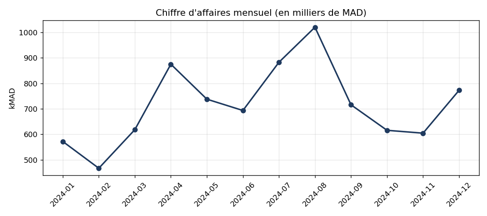
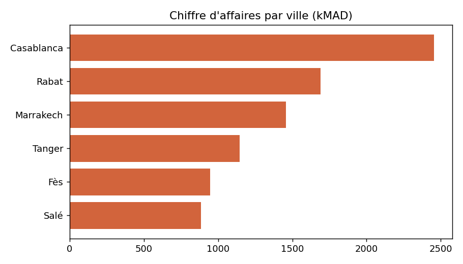
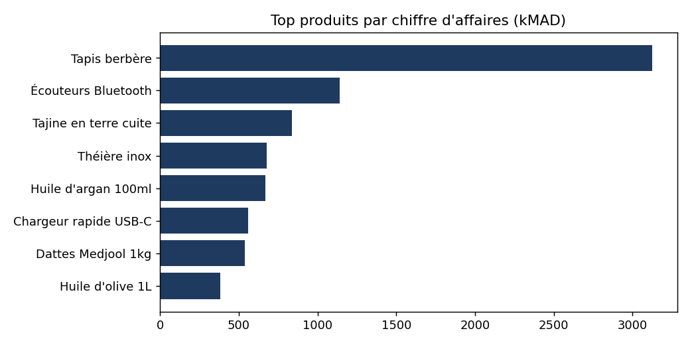

# Retail Sales Data Pipeline


Petit pipeline de données **de bout en bout** : génération de données brutes, nettoyage et contrôle qualité (ETL) avec Python/pandas, stockage dans une base SQL (schéma en étoile) et calcul de KPI métier en SQL avec visualisations.

> **Note :** les données sont **fictives** (générées par `src/generate_data.py`, reproductibles avec une seed fixe). Elles contiennent volontairement des doublons, des dates invalides, des quantités négatives et des valeurs manquantes pour démontrer l'étape de nettoyage.

## Architecture

```
generate_data.py  ->  data/raw/*.csv  ->  etl.py (nettoyage + règles qualité)
                                              |
                                              v
                                   SQLite (star schema)
                                   dim_product, dim_store, fact_sales
                                              |
                                              v
                            kpis.py (requêtes SQL) -> reports/*.csv + *.png
```

## Ce que démontre ce projet

- **ETL avec pandas** : déduplication, validation des dates, filtrage des quantités invalides, intégrité référentielle, calcul du chiffre d'affaires.
- **Modélisation** : schéma en étoile avec contraintes (`CHECK`, clés étrangères) et index (`sql/schema.sql`).
- **SQL analytique** : agrégations, jointures, sous-requêtes, CTE et fonction de fenêtrage `LAG` pour la croissance mensuelle (`sql/kpis.sql`).
- **Qualité** : tests unitaires `pytest` sur les règles de nettoyage + CI GitHub Actions.

## Lancer le projet

```bash
git clone https://github.com/salma-lahrech/retail-sales-data-pipeline.git
cd retail-sales-data-pipeline
python -m venv .venv && source .venv/bin/activate   # Windows : .venv\Scripts\activate
pip install -r requirements.txt

python run_pipeline.py     # génération -> ETL -> KPIs
python -m pytest -q        # tests
```

Résultat attendu : environ 20 150 lignes brutes, environ 19 765 lignes conservées après nettoyage (385 rejetées), et les fichiers de `reports/`.

## Résultats

| Chiffre d'affaires mensuel | Par ville |
|---|---|
|  |  |



Les tables de résultats sont aussi exportées en CSV dans `reports/` (`revenue_by_month.csv`, `revenue_by_city.csv`, `top_products.csv`, `revenue_by_category.csv`, `monthly_growth.csv`).

## Structure

```
├── data/              # données brutes et traitées (générées, non versionnées)
├── reports/           # KPI (CSV) et graphiques (PNG)
├── sql/
│   ├── schema.sql     # DDL du schéma en étoile
│   └── kpis.sql       # requêtes analytiques
├── src/
│   ├── generate_data.py
│   ├── etl.py
│   └── kpis.py
├── tests/test_etl.py
└── run_pipeline.py
```

## Pistes d'amélioration

- Remplacer SQLite par PostgreSQL (le SQL est standard) et orchestrer avec Airflow.
- Connecter Power BI à la base pour un tableau de bord interactif.
- Ajouter un modèle de prévision des ventes (scikit-learn).

## Auteure

**Salma Lahrech** — Ingénieure d'État Data Science & Génie Logiciel · [LinkedIn](https://linkedin.com/in/salma-lahrech)
